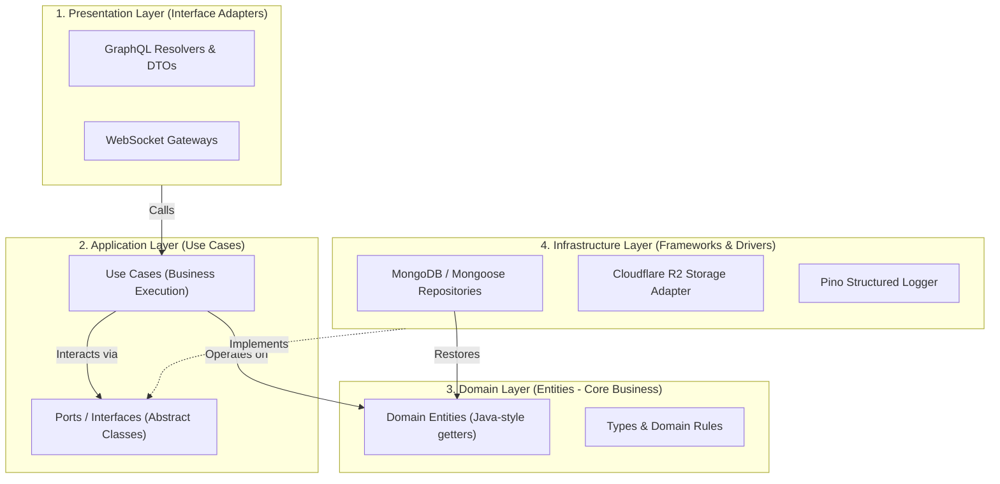
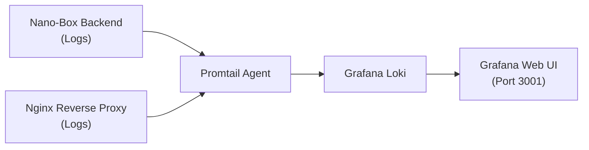

# Nano Box

<p align="center">
  <b>Nền tảng nhắn tin và cộng tác thời gian thực (Real-time Chat & Collaboration Platform)</b>
</p>

<p align="center">
  
  
  
  
  
  
  
  
  
  
</p>

Nano Box là ứng dụng trò chuyện và cộng tác trực tuyến thời gian thực, hỗ trợ nhắn tin trực tiếp 1-1 và theo nhóm với WebSocket độ trễ thấp, tích hợp trình soạn thảo Rich Text (@mention, emoji) cùng khả năng chia sẻ đa phương tiện. Hệ thống được xây dựng theo kiến trúc Clean Architecture trên nền NestJS và Next.js 16 App Router.

---

## Tính năng chính

### Trò chuyện & Cộng tác thời gian thực
- **Direct Messages (1-1) & Group Chat**: Trò chuyện trực tiếp hoặc tạo phòng chat nhóm linh hoạt.
- **WebSocket độ trễ thấp**: Đồng bộ tin nhắn tức thì, trạng thái gửi/nhận và sự kiện thời gian thực.
- **Trình soạn thảo văn bản giàu tính năng (Rich Text)**: Tích hợp Tiptap Editor hỗ trợ định dạng chữ, chèn liên kết, mention người dùng (@mention) và bộ chọn Emoji tiện lợi.
- **Hiệu năng cuộn mượt mà**: Tích hợp danh sách ảo (Virtualized list via `@tanstack/react-virtual`) cho phép tải hàng nghìn tin nhắn mà không giật lag.
- **Xem ảnh & Đính kèm đa phương tiện**: Hỗ trợ xem ảnh phóng to với Lightbox (`yet-another-react-lightbox`), đính kèm tệp tin lưu trữ an toàn trên Cloudflare R2 / S3.

### Mạng xã hội & Quan hệ bạn bè
- **Hệ thống kết bạn**: Gửi lời mời kết bạn, chấp nhận, từ chối hoặc hủy kết bạn.
- **Danh sách & Trạng thái người dùng**: Hiển thị danh sách bạn bè, thông tin cá nhân.
- **Quản lý phòng (Room Management)**: Phân quyền vai trò (Admin / Member), thêm hoặc xóa thành viên khỏi nhóm chat.

### Thông báo & Bảo mật
- **Real-time Notifications**: Nhận thông báo tức thì khi có tin nhắn mới hoặc lời mời kết bạn qua WebSocket và Toast (`sonner`).
- **Xác thực đa phương thức (Auth)**: Hỗ trợ xác thực truyền thống (Email/Password kèm JWT lưu an toàn qua HttpOnly Cookie) và đăng nhập nhanh bằng **Google OAuth**.
- **Data Validation & Sanitization**: Toàn bộ dữ liệu đầu vào được kiểm định chặt chẽ bằng `class-validator` (Backend) và `zod` (Frontend), lọc mã độc XSS bằng DOMPurify.

---

## Kiến trúc hệ thống (System Architecture)

Hệ thống Backend được thiết kế tuân thủ nghiêm ngặt theo **Clean Architecture** với quy tắc phụ thuộc một chiều (The Dependency Rule), tách biệt hoàn toàn nghiệp vụ cốt lõi khỏi database, framework và các công cụ bên ngoài:



---

## Công nghệ sử dụng (Tech Stack)

### Frontend
- **Framework**: [Next.js 16](https://nextjs.org/) (App Router), [React 19](https://react.dev/)
- **UI & Styling**: [Tailwind CSS v4](https://tailwindcss.com/), [shadcn/ui](https://ui.shadcn.com/) (Base Nova primitive với `@base-ui/react`), [Lucide React](https://lucide.dev/)
- **API Client**: [Apollo Client 4](https://www.apollographql.com/docs/react/) kết hợp `@graphql-codegen` tạo type-safe queries/mutations
- **Real-time**: [Socket.io Client](https://socket.io/)
- **State & Form**: [Zustand](https://zustand-demo.pmnd.rs/), [React Hook Form](https://react-hook-form.com/) + [Zod](https://zod.dev/)
- **Editor & Hiệu ứng**: [Tiptap](https://tiptap.dev/), `@tanstack/react-virtual`, `yet-another-react-lightbox`, `emoji-picker-react`

### Backend
- **Framework**: [NestJS 11](https://nestjs.com/)
- **Kiến trúc**: Clean Architecture
- **API & Giao thức**: [GraphQL](https://graphql.org/) (Apollo Server & Nest GraphQL), [WebSockets](https://socket.io/) (Socket.io Gateway)
- **Database**: [MongoDB](https://www.mongodb.com/) với [Mongoose 9](https://mongoosejs.com/)
- **Migration**: [migrate-mongo](https://github.com/seppevs/migrate-mongo)
- **Logging**: [Pino](https://getpino.io/) (`nestjs-pino`, `pino-http`) xuất Structured JSON Log
- **Lưu trữ tệp (Storage)**: Cloudflare R2 / S3 API via `aws4fetch` & `multer`

### Hạ tầng & Vận hành
- **Docker & Docker Compose**: Quản lý và khởi chạy các dịch vụ (Frontend, Backend, Nginx).
- **Nginx**: Reverse proxy điều hướng request và kết nối WebSocket.
- **Loki & Grafana**: Thu thập và xem log tập trung của các container.

---

## Giám sát hệ thống (Monitoring)

Dự án thiết lập sẵn công cụ thu thập và xem log cơ bản từ các container thông qua **Promtail, Loki và Grafana**:



### Cách thức hoạt động:
- **Promtail**: Đọc log trực tiếp từ Docker và chuyển tiếp về Loki.
- **Loki**: Lưu trữ log tập trung từ các dịch vụ.
- **Grafana**: Cung cấp giao diện web trực quan để tìm kiếm và theo dõi log.

### Khởi chạy dịch vụ giám sát:
```bash
# 1. Tạo Docker network dùng chung nếu chưa có
docker network create nano_network

# 2. Khởi chạy cụm Loki + Promtail + Grafana
docker compose -f docker-compose.monitoring.yml up -d
```

### Cổng truy cập:
| Dịch vụ | Cổng | URL | Mô tả |
| :--- | :--- | :--- | :--- |
| **Grafana** | `3001` | `http://localhost:3001` | Giao diện xem log (đã kết nối sẵn Loki) |
| **Loki** | `3100` | `http://localhost:3100` | Cổng nhận log từ Promtail |

> **Ví dụ lọc log trên Grafana Explore:**
> ```logql
> {container_name="nano-box-backend"}
> ```

---

## Cấu trúc dự án (Directory Structure)

```
nano-box/
├── backend/                        # Backend NestJS (Clean Architecture)
│   ├── src/
│   │   ├── common/                 # Pipes, Guards, Decorators dùng chung
│   │   ├── configs/                # Cấu hình MongoDB, Migration, App
│   │   └── modules/
│   │       ├── auth/               # Xác thực (JWT, Google OAuth)
│   │       ├── user/               # Quản lý người dùng & hồ sơ
│   │       ├── friendship/         # Quan hệ bạn bè, kết bạn
│   │       ├── room/               # Phòng trò chuyện & quản lý thành viên
│   │       ├── chat/               # Tin nhắn thời gian thực
│   │       ├── notification/       # Hệ thống thông báo đẩy
│   │       └── upload/             # Tải lên tệp tin (Cloudflare R2 / S3)
│   ├── Dockerfile
│   └── package.json
├── frontend/                       # Frontend Next.js 16 (App Router)
│   ├── src/
│   │   ├── app/                    # Next.js App Router pages & layouts
│   │   ├── components/             # UI Components (shadcn/ui, custom widgets)
│   │   ├── hooks/                  # Custom React hooks
│   │   ├── lib/                    # Apollo client, utilities, socket client
│   │   └── stores/                 # Zustand stores
│   ├── Dockerfile
│   └── package.json
├── monitoring/                     # Cấu hình Monitoring
│   ├── loki-config.yml             # Cấu hình Grafana Loki
│   ├── promtail-config.yml         # Cấu hình thu thập log Promtail
│   └── grafana/provisioning/       # Tự động nạp DataSource vào Grafana
├── docker-compose.yml              # Môi trường chạy chính (Nginx + Frontend + Backend)
├── docker-compose.monitoring.yml   # Cụm giám sát (Loki + Promtail + Grafana)
├── docker-compose.production.yml   # Cấu hình triển khai production
└── nginx.conf                      # Cấu hình Nginx Reverse Proxy & SSL
```

---

## Biến môi trường (Environment Variables)

Trước khi khởi chạy dự án, hãy chuẩn bị các file cấu hình môi trường tương ứng:

### Backend (`backend/.env`)
Tạo file `backend/.env` (hoặc sao chép từ `backend/.env.example`) với các thông số sau:

```env
# Cổng khởi chạy HTTP server
PORT=5050

# Môi trường chạy (development / production)
NODE_ENV=development

# Chuỗi kết nối cơ sở dữ liệu MongoDB
MONGO_URI=mongodb://localhost:27017/nano-box

# Chuỗi bí mật ký JSON Web Token (JWT) và thời hạn hết hạn
JWT_SECRET=your_jwt_secret_key_here
JWT_EXPIRES_IN=7d

# Cấu hình lưu trữ tệp Cloudflare R2 / S3
R2_ACCOUNT_ID=your_cloudflare_account_id
R2_ACCESS_KEY_ID=your_r2_access_key_id
R2_SECRET_ACCESS_KEY=your_r2_secret_access_key
R2_BUCKET_NAME=your_bucket_name
R2_PUBLIC_URL=https://pub-your-id.r2.dev
```

### Monitoring (`monitoring/.env`)
Tạo file `monitoring/.env` để cấu hình tài khoản quản trị cho Grafana:

```env
# Tài khoản và mật khẩu quản trị viên Grafana
GF_SECURITY_ADMIN_USER=admin
GF_SECURITY_ADMIN_PASSWORD=admin

# Cho phép đăng ký tài khoản mới trên Grafana
GF_USERS_ALLOW_SIGN_UP=false
```

---

## Hướng dẫn cài đặt & Khởi chạy (Getting Started)

### Yêu cầu tiên quyết (Prerequisites)
- [Node.js](https://nodejs.org/) v20+ và trình quản lý gói [pnpm](https://pnpm.io/) (`corepack enable pnpm`)
- [Docker](https://www.docker.com/) & Docker Compose
- [MongoDB](https://www.mongodb.com/) (nếu chạy local không qua container)

---

### Cách 1: Khởi chạy nhanh bằng Docker Compose (Khuyên dùng)

Sau khi đã chuẩn bị xong file cấu hình môi trường, khởi chạy toàn bộ hệ thống bằng Docker:

```bash
# 1. Clone repository
git clone https://github.com/your-username/nano-box.git
cd nano-box

# 2. Khởi tạo mạng Docker
docker network create nano_network

# 3. Khởi chạy toàn bộ hệ thống (Nginx, Backend, Frontend)
docker compose up -d

# 4. (Tùy chọn) Khởi chạy thêm cụm giám sát
docker compose -f docker-compose.monitoring.yml up -d
```

Sau khi khởi chạy thành công:
- **Ứng dụng Web**: Truy cập tại [http://localhost](http://localhost) (hoặc qua cổng frontend [http://localhost:3000](http://localhost:3000))
- **GraphQL Playground / Backend**: [http://localhost:5050/graphql](http://localhost:5050/graphql)
- **Grafana Dashboard**: [http://localhost:3001](http://localhost:3001)

---

### Cách 2: Chạy môi trường Local Development

Nếu bạn cần sửa đổi và phát triển mã nguồn trực tiếp:

#### 1. Chạy Backend
```bash
cd backend

# Cài đặt thư viện
pnpm install

# Chạy migration database (nếu cần)
pnpm run migrate:up

# Khởi chạy server ở chế độ watch
pnpm run dev
```
> Backend sẽ lắng nghe tại cổng `http://localhost:5050` (GraphQL endpoint: `http://localhost:5050/graphql`).

#### 2. Chạy Frontend
```bash
cd frontend

# Cài đặt thư viện
pnpm install

# Tạo types từ schema GraphQL mới nhất
pnpm run codegen

# Khởi chạy Next.js dev server
pnpm dev
```
> Frontend sẽ chạy tại `http://localhost:3000`.

