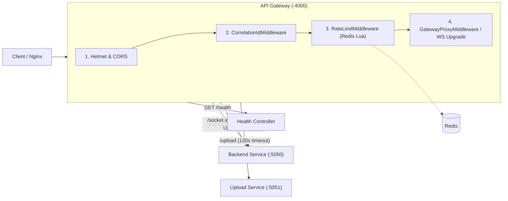

# Nano Box — API Gateway

<p align="center">
  <b>Cổng điều phối trung tâm (Reverse Proxy, Rate Limiting, CORS & WebSocket Upgrade) cho hệ thống Nano Box</b>
</p>

<p align="center">
  
  
  
  
  
</p>

`api-gateway` là điểm vào thống nhất cho toàn bộ lưu lượng API và WebSocket của nền tảng **Nano Box**. Service chịu trách nhiệm điều phối request đến các microservice nội bộ (`backend`, `upload-service`), thực thi giới hạn tốc độ (rate limiting) phân tán qua Redis, quản lý CORS tập trung, gắn `x-correlation-id` để truy vết và làm sạch các header chuyển tiếp trước khi đẩy sang upstream.

---

## Kiến trúc & Luồng xử lý



---

## Tính năng chính

- **Điều phối Reverse Proxy (`GatewayProxyService`)**:
  - Tắt `bodyParser` của Express để stream nguyên vẹn payload (phù hợp với GraphQL và upload tệp dung lượng lớn).
  - Gỡ bỏ các CORS header từ upstream để Gateway kiểm soát CORS tập trung.
  - Trả về phản hồi JSON chuẩn `502 Bad Gateway` khi dịch vụ đích không khả dụng.
- **Hỗ trợ WebSocket Upgrade (`GatewayWsUpgradeService`)**:
  - Xử lý trực tiếp sự kiện HTTP `upgrade` cho `/socket.io` (timeout nâng cấp `10s`).
  - Xác thực đường dẫn (`404`), kiểm tra `Origin` theo `ALLOWED_ORIGINS` (`403`) và áp dụng Rate Limit (`429`) trước khi chuyển tiếp kết nối sang Backend.
- **Rate Limiting phân tán với Redis (`RateLimitService`)**:
  - Sử dụng thuật toán **Sliding Window** viết bằng **Lua script** trên Redis (`rl:gateway:<clientIp>`).
  - Hạn mức mặc định: **120 request / 60 giây** mỗi IP (bỏ qua endpoint `/health`).
  - Trả về đầy đủ header chuẩn: `RateLimit-Limit`, `RateLimit-Remaining`, `RateLimit-Reset` và `Retry-After` (khi vượt ngưỡng `429`).
  - Cơ chế **Fail-open**: nếu Redis gián đoạn, request vẫn được cho qua và ghi cảnh báo log để tránh sập toàn bộ hệ thống.
- **Truy vết & Bảo mật Header**:
  - Tự động sinh hoặc giữ nguyên `x-correlation-id` cho mọi request HTTP và WebSocket.
  - Cấu hình `trust proxy` chỉ tin cậy các subnet nội bộ (`loopback`, `linklocal`, `uniquelocal`).
  - Xóa các header dễ bị giả mạo từ client (`x-forwarded-for`, `x-real-ip`, `x-forwarded-host`, `x-forwarded-port`, `x-forwarded-proto`, `forwarded`, `true-client-ip`, `cf-connecting-ip`) và ghi đè lại bằng IP/protocol đã xác thực.
  - Tích hợp `helmet` và tắt header `x-powered-by`.

---

## Bảng định tuyến (Routing)

| Prefix / Endpoint | Phương thức | Đích chuyển tiếp (Upstream) | Timeout | Ghi chú |
| :--- | :--- | :--- | :--- | :--- |
| `/health` | `GET` | Xử lý trực tiếp tại Gateway | — | Bỏ qua Rate Limit, dùng cho Docker `HEALTHCHECK` |
| `/graphql` | `ALL` | `BACKEND_SERVICE_URL` (`:5050`) | `30s` | GraphQL API chính |
| `/socket.io` | `ALL` / `WS` | `BACKEND_SERVICE_URL` (`:5050`) | `10s` (WS upgrade) | Socket.IO polling & WebSocket thời gian thực |
| `/upload` | `ALL` | `UPLOAD_SERVICE_URL` (`:5051`) | `120s` | Tải tệp lên Cloudflare R2 qua Upload Service |

### Phản hồi `GET /health`

```json
{
  "status": "ok",
  "service": "api-gateway",
  "timestamp": "2026-11-21T11:00:00.000Z"
}
```

---

## Cấu trúc thư mục

```text
services/api-gateway/
├── src/
│   ├── common/
│   │   ├── constants/
│   │   │   └── gateway.enum.ts              # Route prefix, tên service, env keys, header keys
│   │   ├── middlewares/
│   │   │   ├── correlation-id.middleware.ts # Gắn & chuyển tiếp x-correlation-id
│   │   │   ├── gateway-proxy.middleware.ts  # Middleware chuyển tiếp HTTP request
│   │   │   ├── rate-limit.middleware.ts     # Kiểm tra giới hạn tốc độ & gắn RateLimit headers
│   │   │   └── __tests__/                   # Unit test middleware
│   │   ├── services/
│   │   │   └── rate-limit.service.ts        # Redis Sliding Window Lua script
│   │   └── utils/
│   │       ├── client-ip.util.ts            # Xác định IP thực từ trusted proxy subnets
│   │       ├── correlation-id.util.ts       # Chuẩn hóa / tạo mới correlation ID
│   │       ├── proxy-http.util.ts           # Làm sạch header, xử lý lỗi 502 & từ chối WS upgrade
│   │       └── __tests__/                   # Unit test tiện ích
│   ├── configs/
│   │   └── cors-config.service.ts           # Cấu hình & kiểm tra danh sách ALLOWED_ORIGINS
│   ├── proxy/
│   │   ├── gateway-proxy.service.ts         # Khởi tạo proxy route tới các microservice
│   │   └── gateway-ws-upgrade.service.ts    # Xử lý bắt tay WebSocket upgrade
│   ├── app.controller.ts                    # Endpoint GET /health
│   ├── app.module.ts                        # Khai báo module & thứ tự middleware
│   └── main.ts                              # Bootstrap NestJS, Helmet, CORS & gắn WS upgrade
├── test/                                    # E2E tests
├── Dockerfile                               # Multi-stage Docker build (Node 22 Alpine)
├── .env.example                             # Mẫu biến môi trường
└── package.json
```

---

## Biến môi trường

Sao chép `.env.example` thành `.env` trước khi chạy:

```bash
cp .env.example .env
```

| Biến | Bắt buộc | Mặc định | Mô tả |
| :--- | :---: | :--- | :--- |
| `PORT` | Không | `4000` | Cổng HTTP của API Gateway |
| `BACKEND_SERVICE_URL` | Không | `http://localhost:5050` | URL của Backend Service (GraphQL & Socket.IO) |
| `UPLOAD_SERVICE_URL` | Không | `http://localhost:5051` | URL của Upload Service |
| `ALLOWED_ORIGINS` | Không | `http://localhost:3000,https://localhost,http://localhost,https://nano-boxes.id.vn` | Danh sách origin được phép gọi qua CORS & WebSocket (phân tách bằng dấu phẩy) |
| `REDIS_HOST` | Không | `localhost` | Địa chỉ máy chủ Redis cho Rate Limiter |
| `REDIS_PORT` | Không | `6379` | Cổng Redis |
| `REDIS_PASSWORD` | Không | *(trống)* | Mật khẩu Redis (nếu có) |

> **Lưu ý:** Service tự động nạp biến môi trường từ `./.env` và fallback sang `../../.env` ở thư mục gốc.

---

## Cài đặt & Chạy local

### Yêu cầu
- **Node.js** `>= 22`
- **pnpm**
- **Redis** đang chạy (tùy chọn khi phát triển — nếu không có Redis, Rate Limiter sẽ hoạt động ở chế độ fail-open)

### Các lệnh thường dùng

```bash
# Cài đặt dependencies
pnpm install

# Chạy chế độ phát triển (watch mode)
pnpm dev

# Build production
pnpm build

# Chạy bản production sau khi build
pnpm start:prod
```

---

## Kiểm thử & Chất lượng mã nguồn

```bash
# Chạy unit tests
pnpm test

# Chạy unit tests ở chế độ watch
pnpm test:watch

# Tạo báo cáo độ phủ (coverage)
pnpm test:cov

# Chạy E2E tests
pnpm test:e2e

# Kiểm tra lint & định dạng code
pnpm lint
pnpm format
```

---

## Chạy với Docker

### Build & chạy độc lập

```bash
docker build -t nano-box-api-gateway ./services/api-gateway
docker run --rm -p 4000:4000 --env-file ./services/api-gateway/.env nano-box-api-gateway
```

### Chạy cùng toàn bộ hệ thống (Docker Compose)

Từ thư mục gốc của dự án `nano-box`:

```bash
docker compose up -d api-gateway
```

Container chạy dưới quyền non-root user `node` và tích hợp sẵn `HEALTHCHECK` kiểm tra định kỳ `GET /health` mỗi 30 giây.
