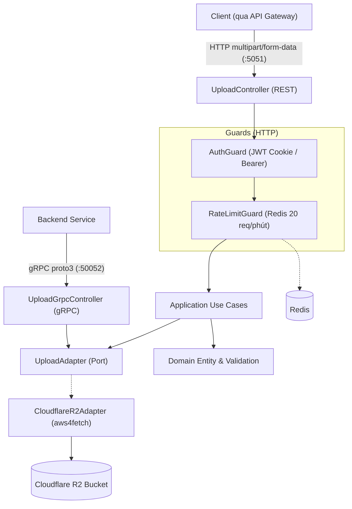

# Nano Box — Upload Service

<p align="center">
  <b>Microservice tải lên, kiểm duyệt và quản lý tệp đa phương tiện trên Cloudflare R2 (REST + gRPC)</b>
</p>

<p align="center">
  
  
  
  
  
  
</p>

`upload` là microservice chuyên trách xử lý tải tệp lên **Cloudflare R2** cho hệ thống **Nano Box**. Service được xây dựng theo kiến trúc **Clean / Hexagonal Architecture** và chạy ở chế độ hybrid (kết hợp **HTTP REST API** cho client upload tệp và **gRPC Server** cho các dịch vụ nội bộ như `backend` xác nhận, sao chép hoặc dọn dẹp tệp tạm).

---

## Kiến trúc hệ thống



---

## Tính năng chính & Bảo mật

- **Hai chế độ tải tệp**:
  - **Upload trực tiếp** (`POST /upload`): lưu vào thư mục được phép (`uploads`, `temp`, `avatars`).
  - **Upload tệp tạm** (`POST /upload/temp`): lưu vào thư mục `temp` và trả về `tempKey` để Backend gọi gRPC xác nhận/chuyển sang thư mục chính thức khi người dùng gửi tin nhắn.
- **Kiểm duyệt tệp ở tầng Domain**:
  - Giới hạn dung lượng tối đa **25 MB** (`MAX_FILE_SIZE = 25 * 1024 * 1024`).
  - Tự động phân loại tệp (`image`, `audio`, `video`, `document`, `other`) và chuẩn hóa MIME type theo phần mở rộng.
  - Chặn các MIME nguy hiểm (`text/html`, `text/javascript`, `application/javascript`, `application/x-javascript`) và ép về `application/octet-stream`.
  - Xác thực **Magic Bytes** cho tệp ảnh (JPEG, PNG, GIF, WebP, BMP, HEIC/AVIF, TIFF, ICO, SVG).
  - Thiết lập `Content-Disposition` an toàn: chỉ cho phép `inline` với các định dạng ảnh raster, audio và video an toàn; các tệp khác (bao gồm SVG và tài liệu) dùng `attachment` để giảm thiểu rủi ro XSS.
- **Xác thực & Giới hạn tốc độ**:
  - `AuthGuard`: xác thực JWT từ cookie `accessToken` hoặc header `Authorization: Bearer <token>`.
  - `RateLimitGuard`: giới hạn **20 lượt upload / 60 giây** theo `user.id` (fallback sang IP) bằng Redis Sliding Window Lua script (`rl:upload:<identifier>`), kèm cơ chế **fail-open** khi Redis lỗi và header `Retry-After` khi vượt ngưỡng `429`.

---

## Giao diện API

### 1. HTTP REST API (cổng mặc định `5051`)

Tất cả endpoint đều yêu cầu xác thực JWT (`AuthGuard`) và áp dụng `RateLimitGuard`. Dữ liệu gửi lên dạng `multipart/form-data` với tên trường là `file`.

#### `POST /upload`
Tải tệp lên thư mục chỉ định qua query string `?folder=uploads|temp|avatars` (mặc định: `uploads`).

- **Response (`201 Created`)**:
  ```json
  {
    "url": "https://your-public-r2-url.com/uploads/1700000000000-photo.png",
    "key": "uploads/1700000000000-photo.png",
    "name": "photo.png",
    "size": 102400,
    "mimeType": "image/png",
    "category": "image"
  }
  ```

#### `POST /upload/temp`
Tải tệp vào thư mục tạm (`temp`) để chờ xác nhận từ dịch vụ khác.

- **Response (`201 Created`)**:
  ```json
  {
    "tempKey": "temp/1700000000000-photo.png",
    "url": "https://your-public-r2-url.com/temp/1700000000000-photo.png"
  }
  ```

---

### 2. gRPC Service (cổng mặc định `50052`)

Định nghĩa tại [`proto/upload.proto`](../../proto/upload.proto) (package `upload`, service `UploadGrpcService`):

| RPC Method | Request | Response | Mô tả |
| :--- | :--- | :--- | :--- |
| `CopyTempToUploads` | `{ temp_key: string }` | `{ url: string }` | Sao chép tệp từ `temp/` sang `uploads/` và trả về URL công khai chính thức |
| `ValidateTempKey` | `{ temp_key: string }` | `{ is_valid: boolean }` | Kiểm tra tính hợp lệ và sự tồn tại của tệp tạm trên R2 |
| `DeleteTempFile` | `{ temp_key: string }` | `{ success: boolean }` | Xóa tệp tạm khi hủy tải lên hoặc dọn dẹp |

---

## Cấu trúc thư mục

```text
services/upload/
├── src/
│   ├── domain/                              # Tầng nghiệp vụ cốt lõi (không phụ thuộc framework)
│   │   ├── uploaded-file.entity.ts          # Domain Entity xử lý chuẩn hóa & validate tệp
│   │   ├── upload.constant.ts               # MIME map, magic bytes, Content-Disposition, giới hạn 25MB
│   │   ├── upload.type.ts                   # Enum UploadFolder, FileCategory, interfaces
│   │   ├── upload.exception.ts              # Ngoại lệ nghiệp vụ
│   │   └── __tests__/                       # Unit tests cho Domain Entity
│   ├── applications/                        # Tầng ứng dụng
│   │   ├── dto/                             # UploadResponseDto, TempUploadResponseDto, FileUploadInput
│   │   ├── ports/
│   │   │   └── upload.port.ts               # Abstract class UploadAdapter
│   │   └── use-case/
│   │       ├── upload-file.use-case.ts      # Use case tải tệp chính thức
│   │       ├── upload-temp-file.use-case.ts # Use case tải tệp tạm
│   │       └── __tests__/                   # Unit tests cho Use Cases
│   ├── infrastructure/
│   │   └── externals/
│   │       └── cloudflare.ts                # CloudflareR2Adapter (giao tiếp S3/R2 bằng aws4fetch)
│   ├── presentation/
│   │   ├── dto/
│   │   │   └── upload-query.dto.ts          # Validation query ?folder=...
│   │   ├── rest/
│   │   │   └── upload.controller.ts         # REST endpoints /upload và /upload/temp
│   │   └── grpc/
│   │       └── upload-grpc.controller.ts    # gRPC handlers cho UploadGrpcService
│   ├── common/
│   │   ├── customs/                         # Domain validation exception
│   │   └── guards/
│   │       ├── auth.guard.ts                # Xác thực JWT (Cookie / Bearer)
│   │       └── rate-limit.guard.ts          # Redis Sliding Window Rate Limiter
│   ├── app.module.ts                        # Khai báo DI binding & module
│   └── main.ts                              # Bootstrap HTTP server + gRPC microservice
├── test/                                    # E2E tests
├── Dockerfile                               # Multi-stage Docker build (context từ thư mục gốc repo)
├── .env.example                             # Mẫu biến môi trường
└── package.json
```

---

## Biến môi trường

Sao chép `.env.example` thành `.env` và điền thông tin Cloudflare R2 & JWT:

```bash
cp .env.example .env
```

| Biến | Bắt buộc | Mặc định | Mô tả |
| :--- | :---: | :--- | :--- |
| `PORT` | Không | `5051` | Cổng HTTP REST API |
| `GRPC_PORT` | Không | `50052` | Cổng gRPC nội bộ |
| `GRPC_HOST` | Không | `0.0.0.0` | Địa chỉ lắng nghe gRPC |
| `JWT_SECRET` | **Có** | `secret_key` | Khóa bí mật xác thực JWT (cần khớp với `backend`) |
| `R2_ACCOUNT_ID` | **Có** | — | Cloudflare Account ID |
| `R2_ACCESS_KEY_ID` | **Có** | — | Access Key ID của Cloudflare R2 |
| `R2_SECRET_ACCESS_KEY` | **Có** | — | Secret Access Key của Cloudflare R2 |
| `R2_BUCKET_NAME` | **Có** | — | Tên R2 Bucket lưu trữ tệp |
| `R2_PUBLIC_URL` | **Có** | — | Domain/URL công khai dùng để truy cập tệp sau khi upload |
| `REDIS_HOST` | Không | `localhost` | Địa chỉ máy chủ Redis cho Rate Limiter |
| `REDIS_PORT` | Không | `6379` | Cổng Redis |
| `REDIS_PASSWORD` | Không | *(trống)* | Mật khẩu Redis (nếu có) |

> **Lưu ý:** Service nạp file `.env` tại `services/upload/.env` và fallback sang `../../.env` ở thư mục gốc.

---

## Cài đặt & Chạy local

### Yêu cầu
- **Node.js** `>= 22`
- **pnpm** (`9.15.4`)
- **Redis** đang chạy (nếu không có Redis, `RateLimitGuard` sẽ tự động chuyển sang fail-open)
- File `proto/upload.proto` tồn tại tại thư mục gốc dự án (`../../proto/upload.proto`)

### Các lệnh thường dùng

```bash
# Cài đặt dependencies
pnpm install

# Chạy chế độ phát triển (watch mode)
pnpm dev

# Build production
pnpm build

# Chạy bản production sau khi build
pnpm start:prod
```

---

## Kiểm thử & Chất lượng mã nguồn

```bash
# Chạy unit tests
pnpm test

# Chạy unit tests ở chế độ watch
pnpm test:watch

# Tạo báo cáo độ phủ (coverage)
pnpm test:cov

# Chạy E2E tests
pnpm test:e2e

# Kiểm tra & tự sửa lỗi lint
pnpm lint

# Định dạng code với Prettier
pnpm format
```

---

## Chạy với Docker

### Build & chạy độc lập

> **Lưu ý:** Cần build từ **thư mục gốc của repository** (`nano-box/`) vì `Dockerfile` sao chép thư mục `proto/` dùng chung.

```bash
docker build -f services/upload/Dockerfile -t nano-box-upload-service .
docker run --rm -p 5051:5051 -p 50052:50052 --env-file ./services/upload/.env nano-box-upload-service
```

### Chạy cùng toàn bộ hệ thống (Docker Compose)

Từ thư mục gốc của dự án `nano-box`:

```bash
docker compose up -d upload-service
```
